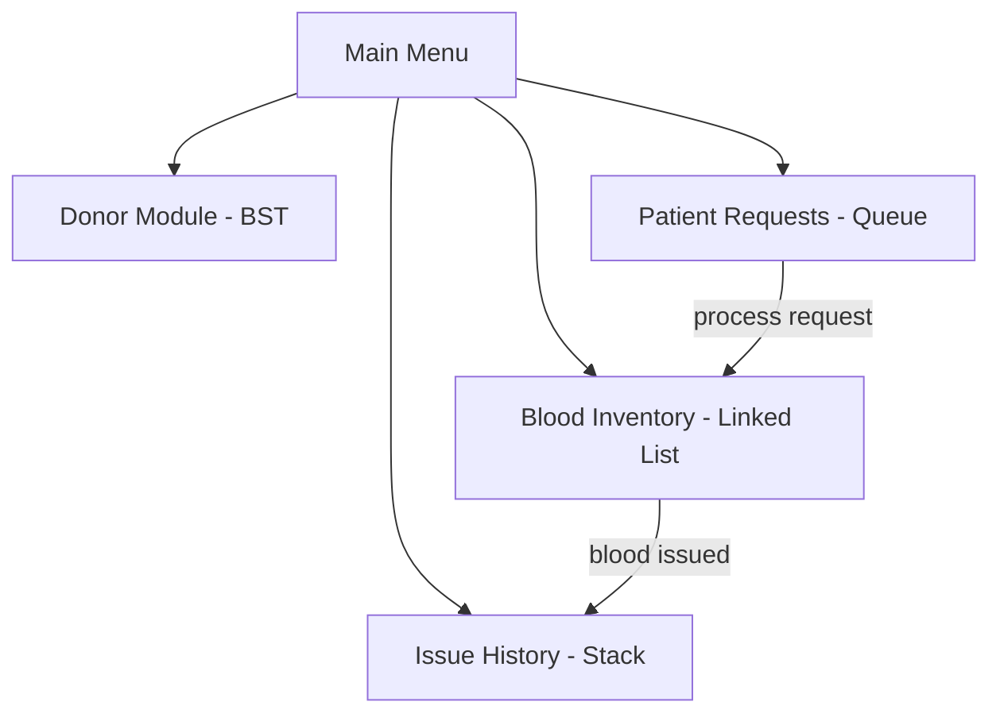
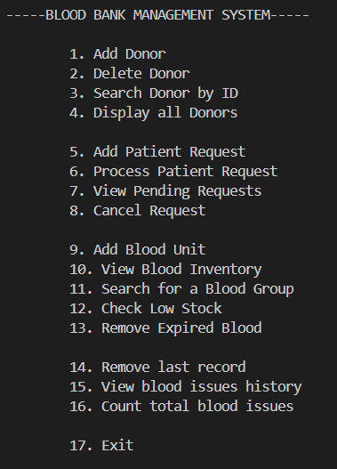
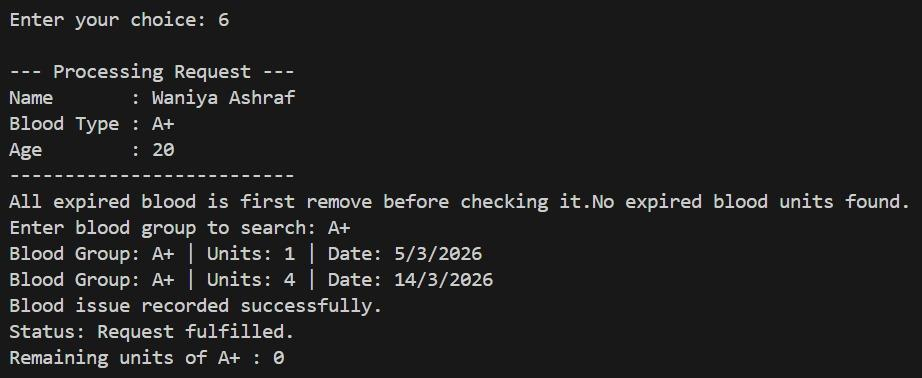
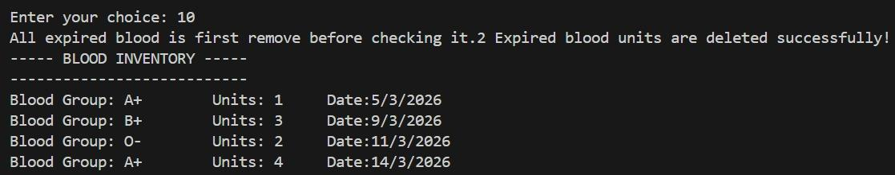
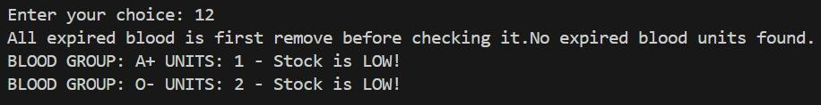
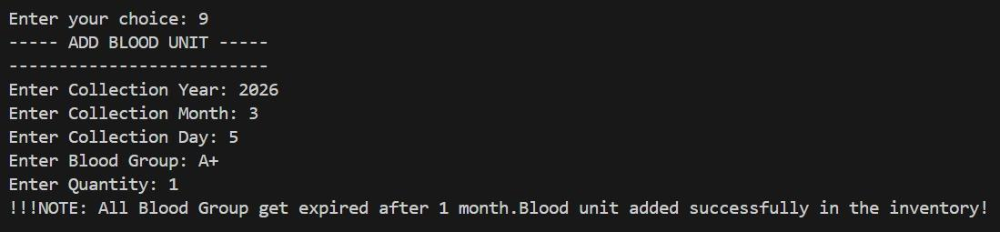
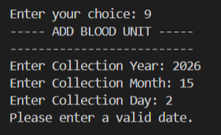

<p align="center">
  
</p>

<p align="center">
  
</p>

<p align="center">
  
  
  
  
  
</p>

<p align="center">
  <b>A console-based blood bank system where every module runs on its own data structure.</b><br>
  Manage donors, track blood stock, serve patients in order, and keep a full issue history.
</p>

---

## 📖 About

Blood banks that track donors, stock and patient requests by hand work slowly and make mistakes. **Red Vault** shows how a computerized system can handle this work, with a different data structure chosen for each job.

Built as a team project for **SE-451: Data Structures and Applications** at UBIT, University of Karachi.

<table align="center">
  <tr>
    <td align="center"><h2>4</h2>Data structures</td>
    <td align="center"><h2>16</h2>Menu operations</td>
    <td align="center"><h2>~720</h2>Lines of C++</td>
    <td align="center"><h2>7</h2>Team members</td>
  </tr>
</table>

---

## 🧠 Data Structures

<table>
  <tr>
    <th align="center">🔗 Linked List</th>
    <th align="center">🧾 Queue</th>
    <th align="center">🌳 Binary Search Tree</th>
    <th align="center">📚 Stack</th>
  </tr>
  <tr>
    <td align="center"><b>Blood inventory</b></td>
    <td align="center"><b>Patient requests</b></td>
    <td align="center"><b>Donor records</b></td>
    <td align="center"><b>Issue history</b></td>
  </tr>
  <tr>
    <td>Stock grows and shrinks constantly, and its size isn't known in advance, so the list resizes itself.</td>
    <td>First in, first out. The patient who asked first is served first.</td>
    <td>Donors are ordered by CNIC, so they can be searched quickly and listed in sorted order.</td>
    <td>Last in, first out. The newest record is on top, so a wrong entry can be undone.</td>
  </tr>
</table>

---

## ✨ Features

| 👤 Donors | 🩸 Blood Inventory | 🧾 Patient Requests | 📜 Issue History |
|---|---|---|---|
| Add with automatic eligibility check | Add units with group, quantity and date | Add requests in arrival order | Every issued unit is recorded |
| Delete (0, 1 or 2 children) | Rejects invalid and future dates | Process: search stock, deduct one unit | View newest first |
| Search by donor ID | Search by blood group | View pending requests | Count total records |
| List in sorted order | Low-stock alert (under 3 units) | Cancel the next request | Undo the last record |
| | Auto-removes units older than 30 days | | |

<details>
<summary><b>✅ Donor eligibility rules</b></summary>

<br>

| Rule | Requirement |
|---|---|
| Age | 18 or older |
| Weight | At least 50 kg |
| Last donation | At least 3 months ago (first-time donors enter 12) |
| Medical history | No major disease from the screening list |

</details>

---

## ⚙️ How It Works



**Request flow:** a request joins the **queue** → when processed, the **linked list** is searched for the blood group → if found, one unit is deducted and the issue is pushed onto the **stack**.

<details>
<summary><b>⏱️ Time complexity of the main operations</b></summary>

<br>

| Operation | Structure | Time |
|---|---|---|
| Add blood unit | Linked List | O(n), walks to the end of the list |
| Search blood group, low stock, expiry check | Linked List | O(n) |
| Add or process a request | Queue | O(1) |
| Add or delete a donor | BST | O(h), about O(log n) when balanced |
| Search donor by ID | BST | O(n) to find the CNIC from the ID, then O(h) |
| Record an issue or undo the last one | Stack | O(1) |

*h is the height of the tree.*

</details>

---

## 📸 Screenshots

<table>
  <tr>
    <td align="center"><b>Main menu</b><br></td>
    <td align="center"><b>Processing a patient request</b><br></td>
  </tr>
  <tr>
    <td align="center" colspan="2"><b>Blood inventory (expired units removed automatically)</b><br></td>
  </tr>
  <tr>
    <td align="center" colspan="2"><b>Low-stock alert</b><br></td>
  </tr>
  <tr>
    <td align="center"><b>Adding a blood unit</b><br></td>
    <td align="center"><b>Date validation</b><br></td>
  </tr>
</table>

<details>
<summary><b>💻 Sample session (example data)</b></summary>

```text
--- Processing Request ---
Name       : Sara Khan
Blood Type : A+
Age        : 20
--------------------------
Enter blood group to search: A+
Blood Group: A+ | Units: 4 | Date: 14/3/2026
Status: Request fulfilled.
Remaining units of A+ : 3
Blood issue recorded successfully.
```

</details>

---

## 🚀 Getting Started

You need a C++ compiler such as **g++** (C++11 or newer).

```bash
# 1. Clone the repository
git clone https://github.com/ibreeqzafar/Red-Vault-Blood-Bank-System.git
cd Red-Vault-Blood-Bank-System

# 2. Compile
g++ -std=c++11 BloodBank.cpp -o redvault

# 3. Run
./redvault          # on Windows: redvault.exe
```

> **Quick try-out:** choose **9** to add blood units (use a recent collection date), **5** to add a patient request, **6** to process it, then **15** to see the issue history.

<details>
<summary><b>📋 Full menu</b></summary>

<br>

| Donors | Patient Requests | Blood Inventory | Issue History |
|---|---|---|---|
| 1. Add Donor | 5. Add Patient Request | 9. Add Blood Unit | 14. Remove last record |
| 2. Delete Donor | 6. Process Patient Request | 10. View Blood Inventory | 15. View blood issues history |
| 3. Search Donor by ID | 7. View Pending Requests | 11. Search for a Blood Group | 16. Count total blood issues |
| 4. Display all Donors | 8. Cancel Request | 12. Check Low Stock | 17. Exit |
| | | 13. Remove Expired Blood | |

</details>

<details>
<summary><b>🗂️ Project structure</b></summary>

```text
Red-Vault-Blood-Bank-System/
├── BloodBank.cpp        # complete source code
├── README.md
└── screenshots/         # program output images
```

</details>

---

## 🛠️ Built With

<p align="center">
  
</p>

---

## 🔮 Roadmap

- [ ] Save data to files or a database (right now everything resets when the program closes)
- [ ] Match compatible blood types (for example O- in emergencies)
- [ ] Accept blood groups in any letter case
- [ ] Add a graphical interface

---

## 👩‍💻 Team

Built by seven students for **SE-451, Data Structures and Applications**, under the supervision of **Ms. Farheen Faisal**, UBIT, University of Karachi (April 2026).

| Name | Role |
|---|---|
| Abeera Faiz | Group Leader |
| Anousha Farhan | Team Member |
| Azwa Ahmed | Team Member |
| Muzna Naveed | Team Member |
| **Umamah Ibreeq Zafar** | Team Member |
| Urwa Munawar | Team Member |
| Waniya Ashraf | Team Member |

---

## 🙏 Acknowledgements

Course lecture notes and publicly available blood bank management projects were used as references while learning and planning this system.

<p align="center">
  <b>⭐ If you found this project useful, consider giving it a star! ⭐</b>
</p>


